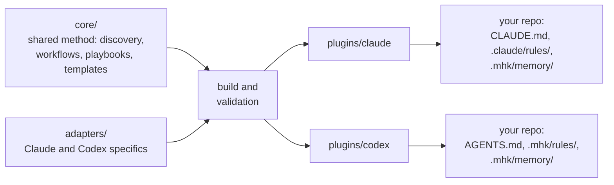

<div align="center">

# Minimal Harness Kit

### Teach your AI agent how your project works.

Turn your codebase into useful rules. Turn team decisions into shared memory.<br>
Keep both in Git, ready for the next session and the next teammate.

[](https://github.com/tungnddev/minimal-harness-kit/actions/workflows/plugins.yml)
[](LICENSE)

**Claude Code · Codex · Native agent files · You approve every change**

[The idea](#the-idea) · [What's included](#whats-included) · [Example](#see-it-on-a-sample-repo) · [Get started](#get-started) · [How it's built](#how-its-built)

</div>

---

Your project has a way of doing things: the command that actually runs the tests, the helper everyone should reuse, the business rule behind an unusual implementation. That knowledge is spread across code, conversations and people's heads, and your AI agent starts every session without it.

**`mhk` turns that knowledge into project context your agent can use.** It scans your repository for rules worth following and helps you keep the decisions code can't explain. You review and commit the result.

## The idea

**Only what your agent would miss.** Your agent already knows its languages, frameworks and good practice, so `mhk` writes down only what it can't work out from the code or tends to get wrong: the command that really runs the tests, the middleware every route needs, the helper to reuse, the reason behind an odd implementation. Everything else is left to the agent's own judgment.

**Native files only.** The output is what your agent already reads: `CLAUDE.md` and `.claude/rules/` for Claude Code, `AGENTS.md` and linked topics for Codex, and team memory as plain Markdown. No server, no background process.

**Generate once, then it works without `mhk`.** The method stays in the plugin; your repo gets only the result. Once committed, every teammate's agent follows the rules, reads team memory and offers to save new facts on any machine, with no `mhk` installed. You need `mhk` only to generate or refresh.

**You stay in control.** Every change is a diff you approve, existing guidance is kept, and `mhk` never commits for you.

## What's included

| Layer | What your agent gets | Claude Code | Codex |
| --- | --- | --- | --- |
| **Rules** | Real commands, project rules, helpers to reuse and examples to follow, in `CLAUDE.md` + `.claude/rules/` or `AGENTS.md` + `.mhk/rules/` | `/mhk:rules`<br>`/mhk:rules-add` | `$mhk-rules`<br>`$mhk-rules-add` |
| **Memory** | Decisions and lessons the code can't show, shared in `.mhk/memory/` | `/mhk:memory` | `$mhk-memory` |

More layers are planned; see [What's next](#whats-next).

Two more commands work across all layers. They maintain what the layers wrote and add nothing your agent reads:

| Command | What it does | Claude Code | Codex |
| --- | --- | --- | --- |
| **Doctor** | A read-only check of what's set up, broken or stale | `/mhk:doctor` | `$mhk-doctor` |
| **Migrate** | After an mhk update, brings existing mhk files to the new format without rescanning | `/mhk:migrate` | `$mhk-migrate` |

## See it on a sample repo

A small npm-workspaces app: an Express order API and a React staff web app. Its README says every API route needs staff auth and prices are integer cents. `/mhk:rules` proposed this root block (trimmed):

```markdown
<!-- mhk:rules:begin -->
# Shopfront

npm-workspaces monorepo: `api/` is the Express 4 order API (TypeScript ESM run with tsx, port 4000); `web/` is the React 18 + Vite staff web app (port 5173).

## Commands
- dev: `npm run dev` (repo root) — starts api and web together
- test: `npm test` (repo root) — Vitest, API workspace only; web has no tests

## Project-specific rules
- Money is integer cents end to end; never use floats for prices (README policy). Existing fields carry a `Cents` suffix (`totalCents`).

### Reuse before building new
- API routes: every route except `/health` must go through `requireStaff` (README policy) — mount new routers in `api/src/server.ts` behind it, take `storeId` only from `requireStaff`, and follow the `orders.ts` router exemplar — see .claude/rules/api.md
- Web pages: render prices with the shared `<Money cents>` component; follow `OrdersPage.tsx` for page layout but not its data fetching — see .claude/rules/web.md
<!-- mhk:rules:end -->
```

<details>
<summary>The scoped topic it points to: <code>.claude/rules/api.md</code> (trimmed)</summary>

```markdown
---
paths:
  - "api/src/**"
---

# API (`api/`)

- Mount each router in `api/src/server.ts` as `app.use('/api/<resource>', requireStaff, <resource>Router)`. Only `/health` is registered without `requireStaff` (README policy).
- Incoming money must be integer cents. Don't copy the `Number(req.body.totalCents)` coercion in the `orders.ts` POST handler — it accepts floats and `NaN`.

| Name | Purpose | Import / location |
| --- | --- | --- |
| `requireStaff` | Staff gate: 401 `{ error: 'unauthorized' }` when the `Authorization` header is missing; otherwise sets `storeId` to the bearer token text before the first `.`. Does not verify signature, expiry, or role. | `./middleware/auth.js` (`api/src/middleware/auth.ts`) |

<!-- mhk:generated -->
```

</details>

The two README policies became rules that cite their source, the shared `requireStaff` and `<Money>` became things to reuse, and code that breaks a policy was flagged instead of offered as an example.

## Get started

```sh
# Claude Code
claude plugin marketplace add tungnddev/minimal-harness-kit
claude plugin install mhk@minimal-harness-kit

# Codex
codex plugin marketplace add tungnddev/minimal-harness-kit
codex plugin add mhk@minimal-harness-kit-codex
```

Then work inside your project: in Claude Code run `/reload-plugins` first; in Codex start a new session.

Start with `/mhk:rules` (`$mhk-rules` in Codex): review the proposed diff and commit it. Run `/mhk:memory` once to turn on team memory; from then on, the agent offers to save lasting facts as you work. Rerun either as the project changes. After updating mhk, run `/mhk:migrate` once per repository. Commands run only when you type them.

[Team installation and updates →](docs/INSTALL.md) · [Rules and memory in depth →](docs/RULES_AND_MEMORY.md)

## Why not just…

| Instead of… | The gap | With `mhk` |
| --- | --- | --- |
| A hand-written `CLAUDE.md`, or a one-off generated draft | It starts the file; keeping it true is manual | Reruns check guidance against the code and propose only justified changes |
| The agent's built-in memory | It lives on one machine, for one person | Approved facts are committed and shared with the team |
| Generic rule packs | The same advice for every repo, loaded on every task | Only project-specific rules, each with its source |
| A memory server or custom tooling | Another service every teammate must install or connect to | Native files only; nothing runs |

## How it's built



- **One method, two agents.** Both plugins are built from one shared source, with concrete instructions for each host.
- **Checked builds.** The build rejects broken templates and references; CI fails when committed packages drift from source.
- **Explicit invocation.** Commands never start themselves (`disable-model-invocation`, `allow_implicit_invocation: false`).
- **Ownership travels with the file.** `mhk` changes only blocks and files it marked as its own. The only side file, `.mhk/version.json`, records which mhk version each platform's files follow.

[Design principles →](docs/DESIGN.md) · [Architecture →](docs/ARCHITECTURE.md)

## What's next

We're exploring project tool selection and work verification: helping teams choose useful AI capabilities, share that setup, and check completed work. These are [proposed next steps](docs/NEXT_PHASE.md). The standalone CLI is currently a placeholder.

## Documentation and contributing

[Rules and Memory](docs/RULES_AND_MEMORY.md) · [Installation](docs/INSTALL.md) · [Design](docs/DESIGN.md) · [Architecture](docs/ARCHITECTURE.md) · [Evaluation](docs/GENERATION_EVAL.md)

Edit shared behavior in `core/` and platform behavior in `adapters/`, then run `npm run build:plugins`, `npm test` and `npm run check:plugins`. The `plugins/` directories hold the generated installable packages; see the [maintainer guide](docs/ARCHITECTURE.md#maintainer-workflow).

## License

[MIT](LICENSE)
